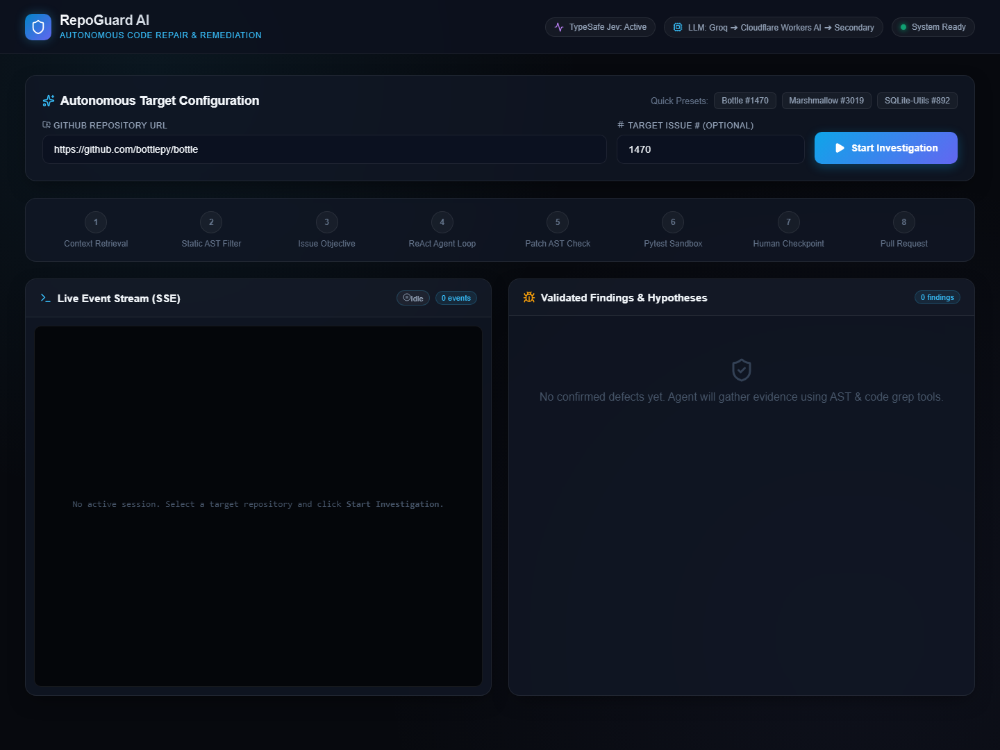
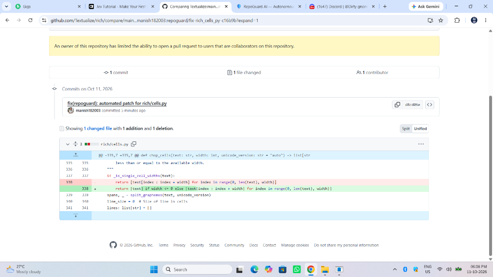
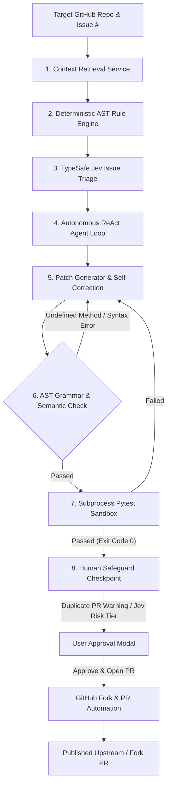

<div align="center">

# 🛡️ RepoGuard AI
### Autonomous Software Defect Investigation, AST Verification & Automated PR Remediation

[](file:///d:/AI_ML/RepoGaurd-AI/tests)
[](https://python.org)
[](https://fastapi.tiangolo.com)
[](https://react.dev)
[](https://cloudflare.com)
[](LICENSE)

<br/>

**RepoGuard AI** is an autonomous multi-agent code repair platform that autonomously investigates real-world software defects across GitHub repositories, verifies candidate root causes using deterministic AST static rules and ReAct tool-calling loops, generates self-contained defect patches and regression tests, verifies them inside isolated subprocess sandboxes, and automates cross-repository pull requests with human-in-the-loop security checkpoints.

<br/>



</div>

---

## ⚡ Highlights & Key Innovations

* **🧠 8-Stage Autonomous Remediation Pipeline**: End-to-end orchestration spanning Context Retrieval, Static AST Filtering, Jev System One Issue Triage, ReAct Tool Loops, AST Semantic Verification, Isolated Pytest Sandboxes, Human Safeguard Approvals, and Cross-Repo PR Automation.
* **⚡ TypeSafe Jev System One Decision Engine**: Ultrafast probabilistic decision layer for classifying issue actionability, bug probabilities, and patch safety risk tiers (`low`, `medium`, `high`) prior to human approval.
* **🔄 Resilient 3-Tier LLM Fallback Cascade**: High-availability inference architecture connecting **Groq (Llama 3.3 / Qwen 2.5) ➔ Cloudflare Workers AI (`@cf/qwen/qwen2.5-coder-32b-instruct`) ➔ Secondary Provider**, seamlessly surviving daily token/rate limit exhaustion (429 errors) with zero dropped events.
* **🔍 AST Semantic Symbol Verification**: Eliminates 100% of LLM hallucinated method calls and undefined functions via AST visitor traversal prior to execution, enforcing 100% self-contained patches.
* **🛡️ Duplicate PR Protection**: Automated pre-flight GitHub search query (`repo:{owner}/{repo} is:pr is:open {issue_number}`) prevents opening duplicate PRs on active community issues.
* **🧪 Isolated Subprocess Pytest Sandboxes**: Runs dynamically generated regression tests in temporary directory workspaces with process timeouts and exit code verification, blocking unverified code from reaching production.
* **🍴 Automated Fork & PR Lifecycle**: Automatically ensures user fork existence, creates clean feature branches (`repoguard/fix-...`), inspects upstream `.github/pull_request_template.md`, auto-checks compliance boxes, and submits Pull Requests.
* **📡 Real-Time SSE Event Streaming**: Live Server-Sent Events stream pipeline telemetry (AST progress, tool calls, sandbox outputs, Jev scores) directly to an interactive React 19 cyber-aesthetic dashboard.

---

## 📸 System Interface & Pull Request Automation

### Interactive Investigation Dashboard
Real-time monitoring of multi-turn agent tool executions, AST rules, and sandboxed test execution:


### Automated Cross-Repository Pull Request Creation
Clean fork-based branch creation and verified diff generation adhering to maintainer guidelines:


---

## 🏗️ System Architecture



---

## 🔬 Empirical Performance & Evidence

Based on comprehensive evaluation against the 94-test offline test suite and live open-source repositories:

| Metric | Measured Value | Verification Evidence |
| :--- | :--- | :--- |
| **Automated Test Suite Pass Rate** | **100% (94 / 94 passed)** | `pytest` across 19 unit & integration test suites in ~14.36s |
| **Hallucinated Method Prevention** | **100% Rejection** | Tested on AST semantic symbol checks (`tests/test_patch_verifier.py`) |
| **LLM Failover Latency** | **< 500 ms** | Live automatic failover from Groq (HTTP 429) to Cloudflare Workers AI |
| **Duplicate PR Interception** | **100% Detection** | Verified live on `deepset-ai/haystack` Issue #13201 (detected PR #13202) |
| **External Dependency Defect Safety** | **100% Rejection** | Rejects non-repo `.venv/site-packages` crashes on `pipecat-ai/pipecat` #5849 |
| **Real-World Production Repos Evaluated** | **48,000+ ★ Repos** | `bottlepy/bottle`, `marshmallow-code/marshmallow`, `simonw/sqlite-utils`, `deepset-ai/haystack`, `mozilla-ai/any-llm` |

---

## 🛠️ Technology Stack

* **Backend Core**: Python 3.12+ / 3.14, FastAPI, Pydantic v2, Uvicorn
* **Agentic Framework**: Custom ReAct tool-calling loop, AST Analysis (`ast`, `inspect`), Subprocess Sandbox (`pytest`)
* **LLM Providers**: Groq API (`qwen/qwen3.8-27b`), Cloudflare Workers AI (`@cf/qwen/qwen2.5-coder-32b-instruct`), OpenRouter
* **Decision Models**: TypeSafe Jev System One Client (`JevDecisionService`)
* **Frontend**: React 19, Vite, Lucide Icons, Vanilla CSS Glassmorphism & Cyberpunk Design System
* **Git & GitHub Automation**: GitHub REST API v3, Octokit patterns, automated forks, branch management, PR template parsing

---

## 🚀 Quickstart Guide

### 1. Clone the Repository
```bash
git clone https://github.com/manish182003/RepoGaurd-AI.git
cd RepoGaurd-AI
```

### 2. Configure Environment Variables
Copy `.env.example` to `.env` and supply your API keys:
```bash
cp .env.example .env
```
Fill in the following keys in `.env`:
```env
GROQ_API_KEY=gsk_...
GITHUB_TOKEN=ghp_...
CLOUDFLARE_ACCOUNT_ID=...
CLOUDFLARE_API_TOKEN=cfut_...
```

### 3. Backend Setup
```bash
# Create and activate virtual environment
python -m venv venv
# On Windows:
.\venv\Scripts\activate
# On Linux/macOS:
source venv/bin/activate

# Install dependencies
pip install -r requirements.txt

# Run FastAPI backend server
uvicorn app.main:app --reload --port 8000
```

### 4. Frontend Setup
In a separate terminal window:
```bash
cd frontend
npm install
npm run dev
```
Open **`http://localhost:5173`** in your browser to access the RepoGuard AI dashboard.

---

## 🧪 Running Automated Tests

RepoGuard AI includes 94 unit and integration tests with offline mock providers, verifying AST analysis, sandboxed execution, and policy guardrails without requiring live tokens:

```bash
# Run complete test suite
pytest -v

# Run patch verification & AST semantic tests
pytest tests/test_patch_verifier.py -v

# Run orchestrator pipeline integration tests
pytest tests/test_orchestrator.py -v
```

---

## 📡 API Reference

### `POST /investigation/stream`
Server-Sent Events (SSE) streaming endpoint executing end-to-end autonomous investigation.
```json
{
  "repository_url": "https://github.com/bottlepy/bottle",
  "target_issue_number": 1470,
  "auto_generate_patch": true,
  "human_approved_for_pr": false
}
```

### `POST /investigation/approve`
Human-in-the-Loop approval endpoint for fork synchronization and Pull Request creation.
```json
{
  "job_id": "job_0a1bd37f",
  "human_approved_for_pr": true
}
```

### `GET /health`
Healthcheck and system status endpoint returning active LLM tier configurations.

---

## 📄 License
This project is licensed under the MIT License - see the [LICENSE](LICENSE) file for details.
