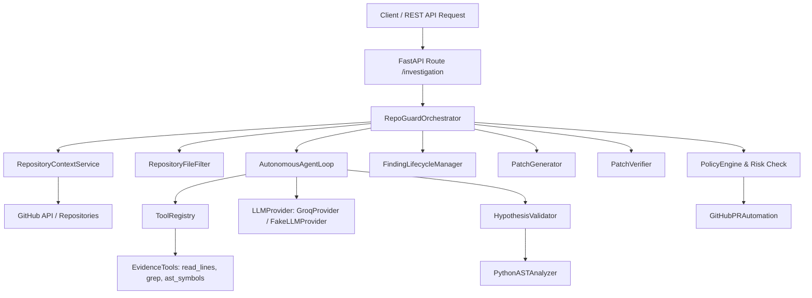

# RepoGuard AI — Backend System Architecture

RepoGuard AI is an autonomous, evidence-backed GitHub code analysis and patch verification agent built with Python, FastAPI, and Groq/OpenRouter LLMs.

---

## High-Level Architecture Diagram

---

## Core Component Responsibilities

1. **LLM Abstraction (`app/llm/`)**
   - `BaseLLMProvider`: Standard abstract interface for LLM calls.
   - `GroqProvider`: Production provider connecting to Groq / OpenRouter using `AsyncOpenAI`.
   - `FakeLLMProvider`: Offline provider for deterministic testing without network calls.
   - Handles token estimation, rate limit retries, and structured JSON parsing.

2. **Policy & Security Engine (`app/core/policy.py`)**
   - Enforces risk levels (`low`, `medium`, `high`).
   - Blocks automated Pull Request creation unless explicitly approved by a human (`human_approved=True`).
   - Redacts API tokens (`ghp_`, `gsk_`, `sk-`) from prompts, logs, and outputs.

3. **Tool Registry & Controlled Execution (`app/tools/registry.py`)**
   - Registers typed Python tool handlers with JSON schemas.
   - Validates parameters before execution.
   - Truncates outputs exceeding character limits to defend against context blowup.

4. **Evidence Gathering Tools (`app/tools/evidence_tools.py`)**
   - `read_source_file_lines`: Reads specific line ranges from source files.
   - `grep_search_code`: Search pattern/keyword across source code.
   - `get_file_ast_symbols`: Extracts Python function, class, and import definitions.

5. **Autonomous Agent Loop (`app/agents/loop.py`)**
   - Multi-turn Python agent loop.
   - Iterates up to `max_iterations` to gather evidence, evaluate hypotheses, and reach an evidence-backed conclusion.

6. **Hypothesis Validation & False-Positive Rejection (`app/tools/hypothesis_validator.py`)**
   - Validates file existence and line boundary references.
   - Parses the complete source file using `ast.parse()` to reject hallucinated syntax errors caused by truncated LLM context.

7. **Finding Lifecycle Manager (`app/tools/finding_manager.py`)**
   - Manages standardized `Finding` objects.
   - Enforces status state transitions (`candidate` -> `investigating` -> `supported` -> `fixed` -> `validated`).

8. **Patch Generation & Verification (`app/tools/patch_generator.py` & `app/tools/patch_verifier.py`)**
   - Generates minimal code replacements and regression tests.
   - Verifies patch application and Python AST syntax in an isolated workspace.

9. **Git & PR Automation (`app/tools/github_pr.py`)**
   - Subject to policy approval, opens GitHub Pull Requests with verified patches.

10. **Pipeline Orchestrator (`app/services/orchestrator.py`)**
    - Connects context building, file filtering, agent investigation, hypothesis validation, patch verification, and PR creation into a single vertical slice.
